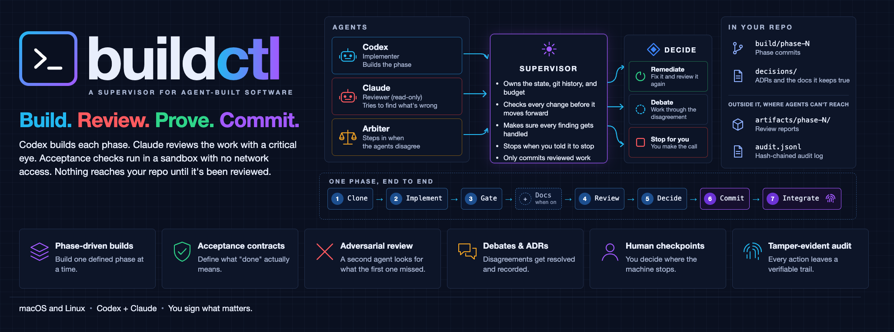
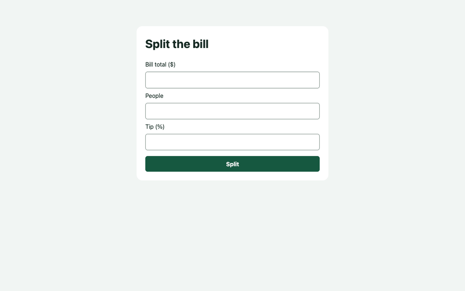
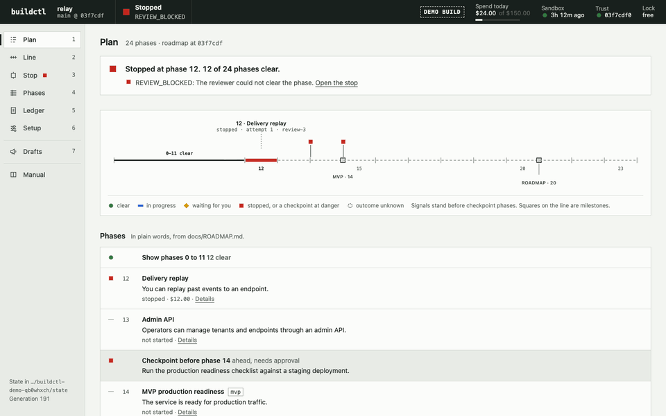
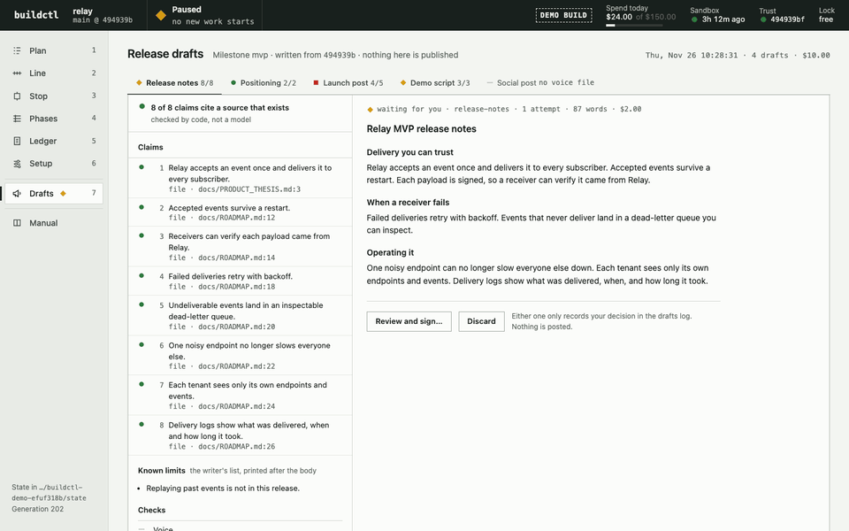

[](LICENSE)


# buildctl

A supervisor for agent-built software. You write a roadmap of phases. buildctl has one agent implement each phase, another review it adversarially, runs your acceptance commands in a sandbox, and commits only what passed. A human approves the phases that matter.

buildctl owns the state, the git history and the budget. Agents never touch any of them. They work in a disposable clone with no remote, and their output is checked before a single byte reaches your repository.

**[Read the manual](https://jej2k5.github.io/buildctl/)**: getting started, how it works, every escalation code and how to clear it, the full command and configuration reference, and what buildctl does and does not guarantee. The same manual is in `docs/` and inside the console at `/docs/`.

**[Watch a real build, end to end](https://jej2k5.github.io/buildctl/#end-to-end)**: one small project from a written brief through discovery, trust, an unattended run with review and docs, a recorded demo and release drafts, with every finding, minute and dollar it took ($16 and 8 minutes for the run).



## Requirements

- macOS (`sandbox-exec`) or Linux (bubblewrap 0.8.0 or newer; see [Running on Linux](https://jej2k5.github.io/buildctl/#linux)).
- Python 3.11 or newer.
- The `codex` CLI (implementer) and the `claude` CLI (reviewer). On macOS, log both in: `codex login`, `claude auth login`. On Linux, give them API keys.

## Install

```sh
pip install -e /path/to/buildctl            # the supervisor
pip install -e '/path/to/buildctl/ui[tui]'  # optional: the console and terminal UI
pip install -e /path/to/buildctl/discover   # optional: discovery that drafts the roadmap
pip install -e /path/to/buildctl/drafts     # optional: release drafts and recorded demos
```

## Quick start

Run these from inside the repository you want built.

```sh
git add build.yaml prompts/ && git commit -m "Roadmap"
buildctl trust init --to "$(git rev-parse HEAD)" --confirm "$(git rev-parse HEAD)"
buildctl isolation verify
buildctl auth check
buildctl bootstrap
buildctl start
```

### Recording agent work

buildctl records what each agent does, shows it live in the console and leaves a checkable receipt for each commit. It is on by default and needs each agent to emit events. Put these flags in the role commands in `build.yaml`:

- implementer (`codex`): `--json`
- reviewer (`claude`): `--output-format stream-json --verbose`

Without them, buildctl refuses to validate, trust or run, with `role implementer command needs --json because recording is on`. To go without recording, add `"evidence": {"recording": "off"}` instead. Either way, `build.yaml` is governed, so commit it and run `trust init` again. A build set up before recording existed needs this once. See [What agents did](https://jej2k5.github.io/buildctl/#evidence) for the full setup, what is recorded and how to check a receipt.

### Debates

When the reviewer raises a design dispute, `"arbiter": {"mode": "debate"}` has Codex argue for the code and Claude for the findings, inside the build, recorded like any other agent work. If they don't agree within `limits.max_debate_turns`, the build waits at `DEBATE_AWAITING_DECISION` and you rule in the console or with `buildctl debate decide`. Each turn reserves `operation_cost_usd.debate_turn`. See [Debates](https://jej2k5.github.io/buildctl/#debates).

### Keeping the docs true

With `"documentation": {"mode": "required", ...}` in `build.yaml`, a documenter updates the README, the docs and the changelog after each phase's gates pass, inside the paths you list. Its own gates check links, the changelog entry and forbidden phrases, and send it back with what failed; the reviewer then reviews the code and the docs together. Editing outside the documentation paths stops the phase at `DOC_SCOPE_VIOLATION`. `optional` mode records documentation failures without stopping. See [Documentation](https://jej2k5.github.io/buildctl/#documentation).

Writing `build.yaml` and phase prompts is covered in the manual's [Writing a roadmap](https://jej2k5.github.io/buildctl/#roadmap). When a build stops, `buildctl status` names the code; the manual's [When it stops](https://jej2k5.github.io/buildctl/#stops) says what clears it.

## The console

`buildctl-ui` opens a local web console over your build, and `buildctl-ui tui` the same in the terminal. It shows the plan, the phase line, every stop with its evidence and remedy, the phases, the audit ledger and setup, and offers only the actions the kernel will accept, with a typed confirmation where they pin or approve something. `buildctl-ui --demo` shows a synthetic build without spending anything; `--demo` takes a scenario: `blocked` (the default), `checkpoint`, `ceiling`, `unknown`, `running`, `debate`, `docs`, `drafts` or `fresh`.



These recordings come from the console's demo builds, made with `buildctl-drafts`' own recorder (see below).

## Release drafts

`buildctl-drafts` writes release material for a finished milestone: release notes, positioning, a launch post, a demo script and a social post in your own voice. Every factual claim must cite a source that exists in the milestone (a commit, an exact quote from a file or the changelog, or an open finding), and plain code checks each one. Nothing is ever posted: you read each draft beside its claims ledger, then sign or discard it in the terminal or in the console's Drafts view. Writer calls count against the build's daily cap.

```sh
buildctl-drafts make --milestone mvp
buildctl-drafts list
buildctl-drafts approve release-notes      # or discard
buildctl-drafts record --milestone mvp     # record the committed demo scenario; free
```

`record` starts the product from the milestone's commit on fictional data, sandboxed with loopback only so it reaches nothing, and drives a headless Chrome through a scenario you commit, capturing a frame per step and a GIF. Recording works on macOS for now. See [Release drafts](https://jej2k5.github.io/buildctl/#drafts) and [Recorded demos](https://jej2k5.github.io/buildctl/#demos).




## Discovery

`buildctl-discover` drafts the roadmap for you. Anyone with the requirements talks to an agent they already use (Claude Code, Codex, Gemini CLI, Claude Desktop); the agent records each decision, proposes phases with acceptance contracts, and asks for a roadmap review, all through MCP tools. The proposal files are rendered from that record, never written by hand. You, the operator, finalize it into the working tree, then commit and trust it as usual. Discovery never commits and never trusts.

```sh
buildctl-discover start                    # in the repository; you are the operator
buildctl-discover check                    # the gate: buildctl validate plus discovery's rules
buildctl-discover status                   # shows the proposal digest
buildctl-discover finalize --confirm <first 8+ characters of the digest>
```

Point the agent at the server. For Claude Code, in `.mcp.json` or with `--mcp-config`:

```json
{"mcpServers": {"discover": {"command": "buildctl-discover",
  "args": ["--repo", "/path/to/repo", "--as", "Sam", "serve"]}}}
```

`serve` runs as the requirements owner; `serve --role operator` also allows accepting risks. The agent should load the server's `discovery_interview` prompt first. The design and its reasoning are in [`docs/planning/discovery-scope.md`](docs/planning/discovery-scope.md).

## Development

```sh
python3 -m unittest discover -s tests -t .
PYTHONPATH=.:ui:drafts python3 -m unittest discover -s ui/uitests -t ui   # the console and the manual (needs rich)
PYTHONPATH=.:discover python3 -m unittest discover -s discover/discovertests -t discover   # buildctl-discover
PYTHONPATH=.:drafts python3 -m unittest discover -s drafts/draftstests -t drafts         # buildctl-drafts
python3 docs/build.py                                            # after editing docs/*.md
```

The kernel suite needs only the standard library. Tests that need the real `codex` CLI, `pytest` or Google Chrome skip when those are absent. `tests/fixtures/target/` is a complete configuration for Relay, a fictional webhook delivery service, used to check that a full configuration validates and to drive the console's demo builds.

## License

buildctl is open source under the [Apache License 2.0](LICENSE). Copyright 2026 John Joseph; see [NOTICE](NOTICE). The `ui/`, `discover/` and `drafts/` packages carry their own copies of both files so each ships its license.
