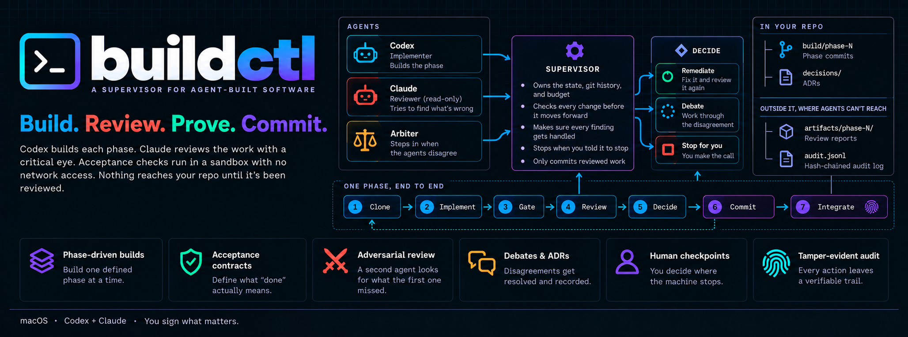

# buildctl



A supervisor for agent-built software. You write a roadmap of phases. buildctl has one agent implement each phase, another review it adversarially, runs your acceptance commands in a sandbox, and commits only what passed. A human approves the phases that matter.

buildctl owns the state, the git history and the budget. Agents never touch any of them. They work in a disposable clone with no remote, and their output is checked before a single byte reaches your repository.

**[Read the manual](https://jej2k5.github.io/buildctl/)**: getting started, how it works, every escalation code and how to clear it, the full command and configuration reference, and what buildctl does and does not guarantee. The same manual is in `docs/` and inside the console at `/docs/`.

## Requirements

- macOS. Agents run under `sandbox-exec`; there is no Linux backend yet.
- Python 3.11 or newer.
- The `codex` CLI (implementer) and the `claude` CLI (reviewer), both logged in: `codex login`, `claude auth login`.

## Install

```sh
pip install -e /path/to/buildctl            # the supervisor
pip install -e '/path/to/buildctl/ui[tui]'  # optional: the console and terminal UI
pip install -e /path/to/buildctl/discover   # optional: discovery that drafts the roadmap
```

## Quick start

Run these from inside the repository you want built.

```sh
git add build.yaml prompts/ && git commit -m "Roadmap"
buildctl trust init --to "$(git rev-parse HEAD)" --confirm "$(git rev-parse HEAD)"
buildctl isolation verify
buildctl auth check
buildctl bootstrap
buildctl start
```

Writing `build.yaml` and phase prompts is covered in the manual's [Writing a roadmap](https://jej2k5.github.io/buildctl/#roadmap). When a build stops, `buildctl status` names the code; the manual's [When it stops](https://jej2k5.github.io/buildctl/#stops) says what clears it.

## The console

`buildctl-ui` opens a local web console over your build, and `buildctl-ui tui` the same in the terminal. `buildctl-ui --demo` shows a synthetic build without spending anything.


## Discovery

`buildctl-discover` drafts the roadmap for you. Anyone with the requirements talks to an agent they already use (Claude Code, Codex, Gemini CLI, Claude Desktop); the agent records each decision, proposes phases with acceptance contracts, and asks for a roadmap review, all through MCP tools. The proposal files are rendered from that record, never written by hand. You, the operator, finalize it into the working tree, then commit and trust it as usual. Discovery never commits and never trusts.

```sh
buildctl-discover start                    # in the repository; you are the operator
buildctl-discover check                    # the gate: buildctl validate plus discovery's rules
buildctl-discover status                   # shows the proposal digest
buildctl-discover finalize --confirm <first 8+ characters of the digest>
```

Point the agent at the server. For Claude Code, in `.mcp.json` or with `--mcp-config`:

```json
{"mcpServers": {"discover": {"command": "buildctl-discover",
  "args": ["--repo", "/path/to/repo", "--as", "Sam", "serve"]}}}
```

`serve` runs as the requirements owner; `serve --role operator` also allows accepting risks. The agent should load the server's `discovery_interview` prompt first. The design and its reasoning are in [`docs/planning/discovery-scope.md`](docs/planning/discovery-scope.md).
## Development

```sh
python3 -m unittest discover -s tests -t .
PYTHONPATH=ui python3 -m unittest discover -s ui/uitests -t ui   # the console and the manual
PYTHONPATH=.:discover python3 -m unittest discover -s discover/discovertests -t discover   # buildctl-discover
python3 docs/build.py                                            # after editing docs/*.md
```

The kernel suite needs only the standard library. Tests that need the real `codex` CLI or `pytest` skip when those are absent. `tests/fixtures/target/` is a complete configuration for Relay, a fictional webhook delivery service, used to check that a full configuration validates and to drive the console's demo builds.

## License

buildctl is open source under the [Apache License 2.0](LICENSE). Copyright 2026 John Joseph; see [NOTICE](NOTICE). The `ui/` and `discover/` packages carry their own copies of both files so each ships its license.
